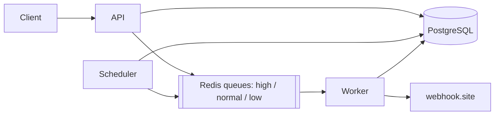

# Notification System

A notification service built with Laravel 13, PostgreSQL and Redis. It accepts SMS, email and
push notifications over a REST API and sends them in the background through queue workers.

## Running the project

You need Docker.

1. Go to [webhook.site](https://webhook.site), copy your URL and click **Edit**. Set the response
   status to `202` and the body to:

   ```json
   { "messageId": "8f14e45f-ceea-467a-9e5b-2b6a1c2f3d4e", "status": "accepted", "timestamp": "2026-01-01T00:00:00Z" }
   ```

2. Copy the env file and put your webhook URL in `NOTIFICATION_PROVIDER_URL`:

   ```bash
   cp .env.example .env
   ```

3. Start everything:

   ```bash
   docker compose up -d --build
   ```

This starts the API (http://localhost:8000), a queue worker, the scheduler, PostgreSQL and Redis.
Migrations run automatically.

- API docs: http://localhost:8000/docs/api (OpenAPI file: [`api.json`](api.json))
- Run tests: `docker compose exec app php artisan test`
- Worker logs: `docker compose logs -f worker`

The passwords and the fallback `APP_KEY` in `docker-compose.yml` are only for local development.

## API

All endpoints are under `/api/v1`. Example requests are in [`request.http`](request.http).

| Method | Endpoint                     | Description                              |
|--------|------------------------------|------------------------------------------|
| POST   | `/notifications`             | Create a notification                    |
| POST   | `/notifications/batch`       | Create up to 1000 notifications          |
| GET    | `/notifications/{id}`        | Get a notification                       |
| GET    | `/notifications`             | List (filters: `status`, `channel`, `batch_id`, `from`, `to`) |
| POST   | `/notifications/{id}/cancel` | Cancel a pending or queued notification  |
| GET    | `/batches/{id}`              | Status counts of a batch                 |
| GET    | `/metrics`                   | Queue depth, success/failure rates, latency |
| GET    | `/health`                    | Database and Redis status                |

Example:

```bash
curl -X POST http://localhost:8000/api/v1/notifications \
  -H "Accept: application/json" -H "Content-Type: application/json" \
  -d '{"channel": "sms", "recipient": "+905551234567", "content": "Flash sale!", "priority": "high", "idempotency_key": "campaign-42-user-1"}'
```

- `channel`: `sms`, `email` or `push`
- `content` limit: 160 characters for SMS, 500 for push, 10000 for email
- `priority`: `high`, `normal` (default) or `low`
- `scheduled_at` (optional): a future date, stored in UTC
- `idempotency_key` (optional): sending the same key again returns the first notification with `200` instead of creating a new one

New notifications return `202 Accepted` because they are only queued at that point, not sent yet.

## How it works



The API saves the notification to PostgreSQL and puts a job on the Redis queue for its priority.
The worker reads `high` first, then `normal`, then `low`, sends the notification to the provider
and updates its status. PostgreSQL is the source of truth; the queue only holds notification ids.

Statuses: `pending` (scheduled) → `queued` → `processing` → `sent` or `failed`.
`pending` and `queued` notifications can be `cancelled`.

## Design choices

**Idempotency.** `idempotency_key` has a unique index and I use `createOrFirst`, so the database
decides if a notification already exists. This also works when the same request comes twice at the
same time. Batches have their own key as well, so retrying a batch request does not create a second
batch.

**No double sends.** Status changes are done with a conditional update
(`UPDATE ... WHERE status = 'queued'`). A worker only sends a notification it managed to move to
`processing`, so a duplicate job or a cancel at the same moment can't cause a second send.

**Rate limit.** Max 100 messages per second per channel. The counter is in Redis so all workers share
it. If the limit is reached the job is put back with a one second delay, without counting as an attempt.

**Retries.** Timeouts, `5xx` and `429` are retried up to 5 times with exponential backoff
(30s, 90s, 270s, 810s) plus some random jitter so retries don't all happen at once. Other `4xx` errors
fail immediately. `attempts` and `last_error` are visible in the API. I chose at-least-once delivery:
after a timeout I retry instead of risking a lost message, and I send the notification id as an
`Idempotency-Key` header to the provider.

**Scheduler.** Runs every 10 seconds. It queues scheduled notifications whose time has come (using
`FOR UPDATE SKIP LOCKED` so two schedulers don't pick the same rows) and requeues notifications that
are stuck in `processing` for more than 5 minutes, for example when a worker crashed.

**Observability.** Every request gets an `X-Correlation-ID`. It is added to all log lines (also in the
worker, through Laravel's `Context`) and sent to the provider. Logs are written as JSON. `/health`
checks PostgreSQL and Redis, `/metrics` shows queue depth per priority, open notifications and per
channel success rate and latency (average and p95) for the last hour.

## Tests

```bash
php artisan test
```

Tests use a separate PostgreSQL database (`notification_system_test`) because the code uses
PostgreSQL features. Queues and HTTP calls are faked. GitHub Actions runs Pint and the tests on every push.

